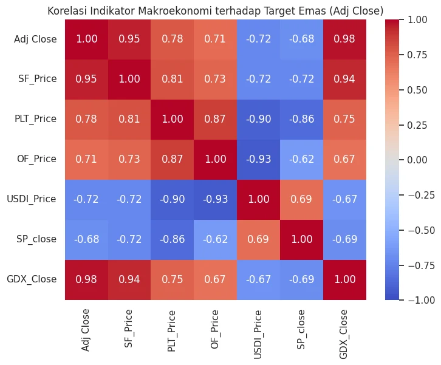
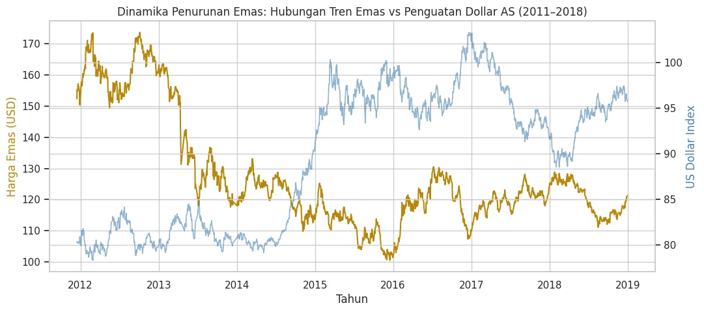
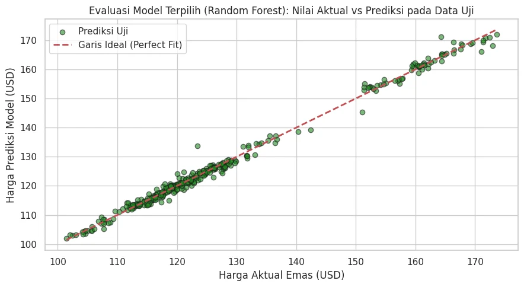
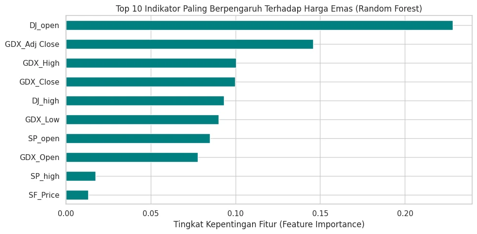

# Prediksi Harga Emas Berdasarkan Indikator Makroekonomi

🥉 **Juara 3 Mini Project Machine Learning, Study Group I-SMILE**

Model regresi untuk memperkirakan **harga penutupan emas** (`Adj Close` ETF emas GLD) dari pergerakan indikator makroekonomi: harga perak, platinum, minyak, Indeks Dollar AS, S&P 500, Dow Jones, dan saham penambang emas GDX.

| Model | CV R² | Test R² | Test MAE | Test RMSE |
|---|---|---|---|---|
| Linear Regression | 0,9870 | 0,9844 | $1,75 | $2,21 |
| **Random Forest** | **0,9944** | **0,9934** | **$0,98** | **$1,43** |

## Latar belakang

Di media sosial sering muncul fenomena **FOMO emas**: orang berbondong-bondong membeli emas saat harganya di puncak karena menganggap emas pasti selalu naik. Padahal harga emas juga bisa turun tajam dalam beberapa tahun.

- **Pertanyaan:** bisakah pergerakan indikator makroekonomi memperkirakan nilai wajar harga emas?
- **Target:** `Adj Close` (regresi)
- **Calon pengguna:** investor ritel pemula yang butuh acuan objektif sebelum membeli emas.

## Dataset

`FINAL_USO.csv`: **1.718 hari bursa (2011–2018)**, 81 kolom. Notebook mengunduhnya otomatis dari Google Drive lewat `gdown`.

Setelah pembersihan tersisa **74 fitur** dari aset eksternal: S&P 500 (`SP_*`), Dow Jones (`DJ_*`), saham GDX (`GDX_*`), perak (`SF_*`), platinum (`PLT_*`), minyak (`OF_*`, `OS_*`), Indeks Dollar AS (`USDI_*`), dan lain-lain.

## Temuan EDA

| Korelasi indikator terhadap emas | Emas vs Indeks Dollar AS |
|---|---|
|  |  |

- Emas berkorelasi **positif sangat kuat** dengan saham GDX (0,97) dan perak (0,86).
- Emas berkorelasi **negatif kuat** dengan Indeks Dollar AS (−0,72) dan S&P 500 (−0,68).
- Pada 2013–2015 harga emas turun dari sekitar $165 ke $100 saat dollar menguat. Ini bukti bahwa emas juga bisa turun dalam waktu lama.

## Pembersihan data

| Masalah | Tindakan | Alasan |
|---|---|---|
| Nilai kosong | Dicek, 0 baris | Tidak perlu imputasi |
| Duplikat | Dicek, 0 baris | Setiap baris adalah tanggal bursa unik |
| Kebocoran target | Hapus `Open`, `High`, `Low`, `Close`, `Volume` emas | Model tidak boleh menebak dari harga emas di hari yang sama |
| Kolom tanggal | Hapus `Date` dari fitur | Model memakai hubungan antar-aset, bukan urutan waktu |

## Pemodelan

- **Split:** 80% latih (1.374 baris) dan 20% uji (344 baris).
- **Model:** Linear Regression (dengan `StandardScaler`) sebagai model standar, dibandingkan dengan Random Forest Regressor (`n_estimators=100`, `max_depth=10`).
- **Validasi:** 5-fold cross validation pada data latih, lalu evaluasi akhir pada data uji.

## Hasil

| Prediksi vs aktual (data uji) | 10 indikator paling berpengaruh |
|---|---|
|  |  |

Random Forest dipilih sebagai model akhir:

- **R² 0,9934:** 99,34% variasi harga emas dapat dijelaskan oleh indikator makroekonomi.
- **MAE $0,98:** rata-rata selisih prediksi dengan harga sebenarnya kurang dari satu dollar.
- **Tidak overfitting:** selisih R² latih (0,9990) dan uji (0,9934) di bawah 1%.

**Keterbatasan:** model dilatih dari data historis, jadi tidak bisa memprediksi lonjakan harga akibat kejadian mendadak seperti krisis geopolitik atau tren viral.

## Menjalankan

Paling mudah lewat **Google Colab**: buka `Mini_Project_ISMILE_Kel1.ipynb`, lalu jalankan semua sel. Sel yang memakai `drive.mount` boleh dilewati, karena dataset sudah diunduh otomatis dengan `gdown`.

Untuk menjalankan secara lokal:

```bash
pip install pandas numpy matplotlib seaborn scikit-learn gdown jupyter
jupyter notebook Mini_Project_ISMILE_Kel1.ipynb
```

## Tim

| Anggota | Peran | Kontribusi |
|---|---|---|
| **Deftrian Dwi Wicaksana** | Data Analyst & Preprocessing | Rumusan masalah, EDA dan 3 visualisasi beserta temuannya, pembersihan kebocoran target, slide bagian 1–5 |
| Yosafat Adventio Djentoe | Machine Learning Engineer | Split dan scaling data, Linear Regression dan Random Forest, 5-fold CV, evaluasi, slide bagian 6–9 |

Portofolio: [badakganteng31.github.io](https://badakganteng31.github.io)
